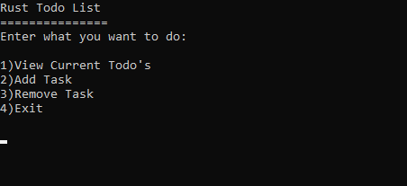

## Todo: Learn Rust
A super simple CLI based todo list with persistence written completely in Rust! <br>
(Did i mention this is my first Rust project?)<br><br>



## Features
Add and Remove Tasks <br>
View Current Tasks <br>
(Kinda basic i know i will add some more stuff later on)

## Tech Stack
Rust - Core Programming Language <br>
Standard Library - File handling and data management

## How to run?
Just grab the exe file from the releases and run it! <br>
Rust not required for running!<br>
**IMPORTANT: Currently the program only runs on windows and might break if ran on Linux or Mac**

## How it works?
The application stores tasks in a vector String while running.<br>
When the application starts, it checks for an existing data file and loads previously saved tasks. When the user exits, the current task list is written back to the file.<br>

## Project Structure
```text
.
├── src/
│   └── main.rs
├── asset/
│   └── image.png
├── .gitignore
├── Cargo.lock
├── Cargo.toml
└── README.md
```

## Limitations and Future Improvements
This project is pretty bare bones right now as this is my first ever Rust project and this was made mostly as a learning project.<br>
I do hope to refine the code and add some improvements like:

- Make a better looking CLI using RataTUI
- Handle file errors more gracefully.
- Improve the command-line interface.
- Add Mac and Linux support

